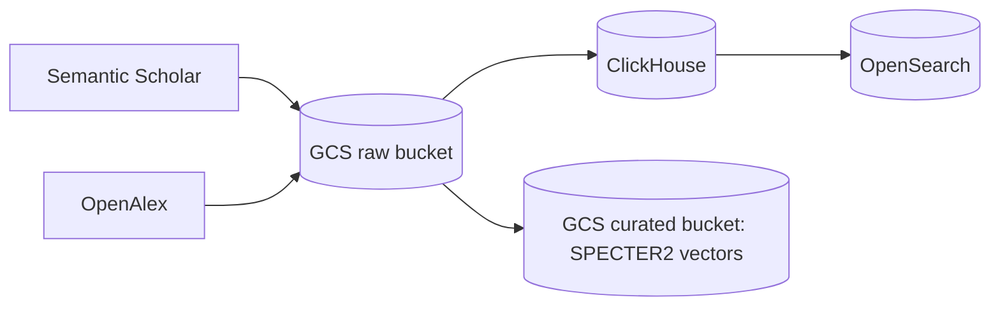

# OpenKnowledge

Data pipelines behind OpenKnowledge, an open-source platform for finding and surveying
research literature. This repository archives the
[Semantic Scholar](https://www.semanticscholar.org/product/api) and
[OpenAlex](https://openalex.org) datasets, loads them into ClickHouse and indexes papers
into OpenSearch for search.



- **Archive.** Every release and diff is pinned and stored as received, with checksums
  and a manifest, so a load can always be replayed from the raw bucket.
- **Load.** ClickHouse reads the archived files directly, checks each record against the
  dataset's contract and records what it applied, so reruns skip finished work.
- **Index.** Paper, abstract and TL;DR rows become one search document per paper, written
  to a versioned index behind the `papers` alias.

Work runs as [Prefect](https://www.prefect.io) flows; large downloads and conversions run
as Google Cloud Batch jobs. The Google Cloud resources they run on are managed in a separate infrastructure
repository.

## Repository layout

| Path | Contents |
| --- | --- |
| `packages/contracts` | Pydantic models for datasets, identifiers, manifests, tables and the search document |
| `packages/core` | Ingestion, embedding and search logic, with ports as Protocols and no framework imports |
| `packages/adapters` | Implementations of those ports for GCS, Cloud Batch, ClickHouse, OpenSearch, Semantic Scholar and OpenAlex |
| `pipelines` | Settings, Prefect flows, the `okp` command line and the container image |
| `migrations/clickhouse` | Numbered ClickHouse schema migrations |
| `tests` | Cross-package and end-to-end tests |

Dependencies point one way: `pipelines` > `adapters` > `core` > `contracts`.
[AGENTS.md](AGENTS.md) lists the architecture rules CI enforces.

## Getting started

Requires Python 3.12 and [uv](https://docs.astral.sh/uv/).

```sh
uv sync --all-packages --all-extras
uv run okp --help
```

| Command | Purpose |
| --- | --- |
| `okp s2` | Pin, download, archive, load and sync Semantic Scholar datasets |
| `okp openalex` | Pin, archive and load OpenAlex snapshots |
| `okp embeddings` | Convert SPECTER2 vectors and look them up by corpus ID |
| `okp search` | Queue the paper indexing run |
| `okp serve`, `okp serve-index` | Serve the Prefect deployments on the control and OpenSearch VMs |
| `okp admission` | Open and close the deployment admission gate |

Settings come from the environment: `S2_API_KEY`, and `OKP_` followed by a field name from
[`settings.py`](pipelines/src/openknowledge_pipelines/settings.py). Commands that change
data need the shared Prefect server (`PREFECT_API_URL`) and an open admission gate.

## Development

Run these before opening a pull request; CI runs the same checks:

```sh
uv run pytest -q
uv run ruff check . && uv run ruff format --check .
uv run pyright
uv run lint-imports
```

End-to-end tests start ClickHouse, OpenSearch, Prefect and a fake GCS from
[`tests/e2e/compose.yaml`](tests/e2e/compose.yaml) and are skipped locally without
Docker. SQL tests are skipped without a `clickhouse` binary on the `PATH`.

## Documentation

- [Semantic Scholar archives](docs/semantic-scholar.md): local and Batch downloads,
  full-text and SPECTER2 archives, the coordinated sync
- [Loading into ClickHouse](docs/clickhouse.md): loads, diffs, migrations, read tables,
  OpenAlex, watchdog
- [SPECTER2 vector lookup](docs/embeddings.md)
- [Indexing papers into OpenSearch](docs/search-indexing.md)
- [Deployment](docs/deployment.md): the pipelines image and deployment admission

## License

[GNU Affero General Public License v3.0](LICENSE).
